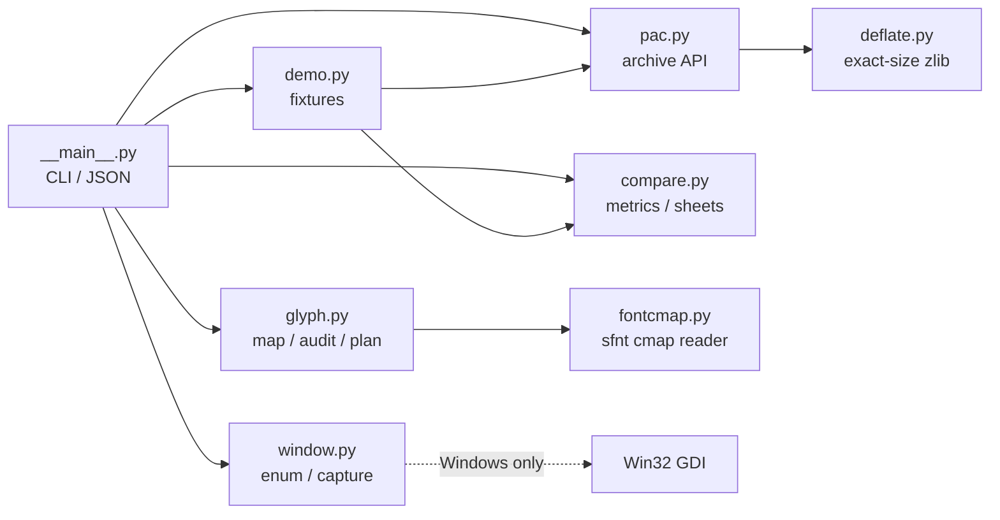

# Design notes

## Goals

`galgame-remaster-kit` is a small set of composable tools for legacy visual-novel
research:

1. understand and safely rebuild a sequential-zlib asset container;
2. audit and apply CJK glyph substitutions against a real font;
3. measure display-pipeline candidates on the image that reaches the panel.

The repository is intentionally **not** a game-specific patcher. It contains no
extraction command that dumps a game's assets, no translation database, and no
platform-specific offsets. It is a toolchain plus a methodology.

## Module graph

```text
                   +--------------+
                   | __main__.py  |  argparse, exit codes, JSON output
                   +------+-------+
                          |
        +-----------------+------------------+----------------+
        |                 |                  |                |
   +----v----+       +----v-----+       +----v-----+      +---v----+
   | pac.py  |       | glyph.py |       |compare.py|      |window.py|
   +----+----+       +----+-----+       +----------+      +--------+
        |                 |
   +----v----+       +----v------+
   |deflate.py|      |fontcmap.py|
   +---------+       +-----------+
```

`demo.py` builds deterministic synthetic fixtures for all of the above.
`window.py` is Windows-only and read-only; importing the package on other
platforms is safe.



## Rebuild data flow

```text
read archive
  -> scan stream boundaries with zlib.decompressobj()
  -> record (offset, csize, usize) for every stream
  -> preserve footer bytes
  -> for each replacement:
       compress payload to exactly the old csize
       verify zlib.decompress(out) == payload
  -> concatenate header + streams + footer
  -> re-parse the result from scratch
  -> compare count/version/csize/footer/untouched bytes
  -> write atomically (optional backup)
```

The rebuild is intentionally verified twice: once while constructing the
stream and once by parsing the final byte string. The second pass catches
off-by-one errors in the concatenation that a per-stream check cannot see.

## Error model

| exception | meaning |
|---|---|
| `PacFormatError` | input is not a supported archive or a stream is truncated |
| `RepackError` | a replacement cannot fit or the resulting archive fails verification |
| `ExactSizeError` | no zlib encoder setting produced the requested byte size |
| `FontFormatError` | the font is not a supported sfnt/TTC or has no usable cmap |
| `UnmappedGlyphError` | strict encoding/audit found a character with no mapping |
| `AmbiguousGlyphError` | strict decoding found several sources for one target |
| `WindowError` | a window is missing, inaccessible, or the platform is not Windows |

CLI exit codes:

- `0` — command completed;
- `1` — a comparison/audit found a difference (`pac diff --fail-on-diff`, a
  strict glyph audit, a font with missing characters);
- `2` — invalid input, missing file, unsupported format, or an OS error.

`--json` output is designed for scripts; human output is a table or a short
summary. No command writes into the source archive unless `--in-place` is
explicitly requested; that mode creates a one-time `.bak` file.

## Invariants

The archive module treats these as hard requirements:

1. total file size unchanged;
2. stream count and version unchanged;
3. every compressed stream keeps its original `csize`;
4. untouched streams are byte-identical;
5. the footer is byte-identical;
6. every replacement decompresses back to the exact input payload;
7. every returned zlib stream has a final block.

The glyph module treats these as hard requirements:

1. every mapping key/value is a single character;
2. a mapping table can contain identity entries for font-native characters;
3. reverse mappings that are ambiguous are reported;
4. a strict audit fails when a non-ASCII character has no mapping or no glyph.

The compare module treats these as hard requirements:

1. images are normalized to the same size before metrics;
2. `edge_energy` is only compared on identical dimensions/content;
3. metrics are reported with the threshold used for changed-pixel counting;
4. the comparison sheet shows the same region as the metrics.

## Testing strategy

- **Synthetic fixtures** for archives, fonts, and images. No game data.
- **Unit tests** for each parser and error path.
- **Property-style tests** with a seeded RNG: random payloads, random archive
  counts, random tails, and rebuild round-trips.
- **CLI tests** that exercise JSON output and exit codes.
- **Platform tests**: cmap parser is cross-platform; the Windows window module
  is tested through pure filter logic, and OS calls are only made where
  available.
- **Repository guard**: fails on media/binary extensions, oversized files,
  absolute home paths, and hash-like strings.

## Performance notes

- Archive scanning decompresses each stream once while locating boundaries; it
  does not store all decompressed payloads.
- `pac diff` hashes only streams whose compressed bytes differ.
- `pac stats` hashes all payloads to find duplicates; use it on archives of
  reasonable size.
- Exact-size compression searches a bounded set of encoder settings. The first
  successful setting returns early.
- Image metrics use Pillow's C-level operations; no NumPy dependency.

## Why no extraction command

A generic “extract all assets” button is the easiest way to turn a research
tool into a redistribution tool. This repository deliberately stops at
inspection, verification, diffing, and rebuilding. Users who need individual
assets can use a small script against the documented API; the project does not
ship a one-command dumper.

## Extensibility

- Add a new container reader with the same `StreamInfo`-style metadata and a
  rebuild verifier.
- Add cmap formats 2/13/14 by following the `_parse_subtable` dispatch.
- Add image metrics that operate on Pillow images and return a `Metrics`-like
  dataclass.
- Add Windows display-mode queries without changing the capture module; keep
  any mode-changing API behind an explicit opt-in.

## Relationship to the case study

The case study in `docs/case-study.md` explains the workflow that motivated the
tool. The code and docs are sanitized: no titles, hashes, offsets, screenshots,
or translated strings from a commercial product. The synthetic demo is the
reference for every command in the README.
