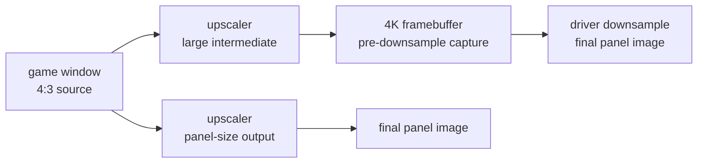

# Display experiment log (sanitized)

This log records the display-quality search that led to the toolkit's A/B
method. It is deliberately scene-generic: the test material was a 4:3 menu and
a text-heavy settings page, not a redistributed game capture. Numbers are from
specific captures and are not universal constants.

## Setup

- Panel: 2560×1440.
- Baseline upscaler: a real-time anime upscaler with a denoise/upscale/restore
  chain.
- Baseline path: 4K virtual desktop, upscale to 2880×2160 content, driver
  downsample to 1440p.
- Capture: window client area at the native window size; final-output crops
  normalized to the same content dimensions.
- Metrics: mean absolute difference, PSNR, edge energy, changed fraction, and
  a visual 2–4× nearest-neighbor crop.

`compare.py` implements the metrics and the labeled sheets.

## Experiments

| id | hypothesis | change | observation | decision |
|---|---|---|---|---|
| E0 | Baseline is good enough | 4K virtual desktop + upscaler + driver downsample | Sharp at the 4K framebuffer; the final panel image is softer than that capture | Reference |
| E1 | A contrast-adaptive sharpening tail pass adds acutance | Append CAS with strength 0.3, 0.4, 0.5 | 0.5 produced clear white halos; 0.3/0.4 were subtle and scene-dependent | Reject; baseline already sharpens |
| E2 | A different upscaler plus a thinning pass wins on line art and text | Swap to CuNNy HQ and add a thinning pass | Full-frame mean difference ≈0.9/255; text edge energy ≈9% lower than baseline; line art slightly cleaner, text softer | Reject; not a clear win |
| E3 | The 4K supersampling chain is not automatically sharper | Compare final-panel direct output vs a 4K framebuffer downsampled to the same size | Direct output had cleaner glyph edges and fewer resampling artifacts in 1:1 crops; the extra upscale/downsample pair softened text | **Adopt direct output** |
| E4 | FP32 reduces banding | Disable FP16 in the upscaler | Mean difference ≈0.07/255, max 2 levels; no visible change in the test scene | Reject; keep FP16 |
| E5 | A different capture method improves clarity | Try alternate capture methods | One method failed to present the scaled window; another produced a smaller centered output; the default was the only one with the expected destination rectangle | Keep default |
| E6 | A newer upscaler build improves quality | Check the latest release vs local | Local matched the latest release | No change |
| E7 | Lower DSR smoothness increases final sharpness | Change the driver DSR smoothness | Requires administrator/UAC elevation; not executed. After E3 the DSR path is no longer the default | Deferred; irrelevant to the chosen path |
| E8 | Monitor OSD sharpness adds hidden sharpening | Check the monitor menu | Not automatable; leave at the calibrated/default value | Manual check |

## Why E3 won

The two paths produced the same final content size:

The supersampling path has an extra upscale and a downsample. The direct path
has one upscale.

The supersampling path has more source pixels, but it also adds two resampling
steps. In the text crops, the direct path preserved cleaner stroke edges and
had fewer halos/resampling textures. The conclusion is not “higher resolution
is bad”; it is “measure the final output, and count every resampling step.”

A second benefit was operational: the direct path removed a display-mode switch
and reduced GPU load. It also made the test deterministic because the captured
image was already the final panel image.

## Guardrails used during the search

1. Fix the scene and capture timing. A title animation or a cursor can create
   false differences.
2. Change one variable per run.
3. Keep a baseline configuration and a one-line rollback.
4. Reject any candidate with visible halos, even if edge energy rises.
5. Compare the final output, not an intermediate framebuffer.
6. Do not stack a sharpener on top of a sharpener without a visual check.

## What would be tested next

- A dark-gradient scene for FP32 banding, with a histogram/banding metric.
- A motion scene for temporal aliasing and frame pacing.
- A perceptual metric (for example SSIM) in addition to edge energy.
- A blind A/B with multiple scenes and a fixed viewing distance.
- A hardware capture path for true post-scanout comparison.

## Decision summary

- Use the direct panel-resolution output when the source is upscaled by a
  small factor and the alternative adds a downsample.
- Keep the baseline upscaler; do not add a sharpening tail pass without a
  scene-specific win.
- Keep capture settings stable; a wrong capture method can invalidate the
  entire comparison.
- Record the exact configuration and a rollback path with every result.
